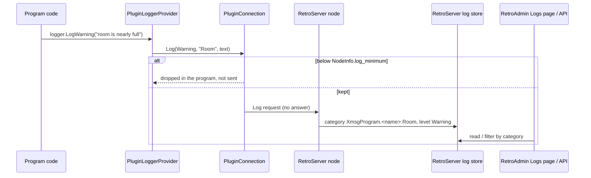

# Logging

A program sends its log lines to RetroServer over the connection it already has. RetroServer keeps them with its own
log lines, so they show in RetroAdmin's **Logs** page and through the logs API, next to what RetroServer itself
logged at the same moment.

## Levels

The same six levels RetroServer uses, with the same numbers: Trace (0), Debug (1), Information (2), Warning (3),
Error (4), Critical (5). `None` (6) is used only as a minimum level and means nothing is kept.

## How a line travels



- The **category** is `XmsgProgram.<plugin_name>`, plus `.<category>` when the program gave one.
- RetroServer stamps the line with its own time. When the program's time (`unix_time_ms`) differs by more than a
  second, it is put in front of the text as `[program time ... UTC]`, so a wrong clock or a slow link is visible.
- A `Log` request is **never answered**, so logging never waits on RetroServer. A line written after the connection
  has ended is lost; it still went to the program's own console if the program logs there too.

## In a C# program

```csharp
using Microsoft.Extensions.Logging;
using RetroIO.Protocols.Xmsg.Plugins.Client;

await using PluginConnection node = await PluginConnection.ConnectAsync(channel, "my-server", "1.0", token);
using PluginLoggerProvider toRetroServer = new PluginLoggerProvider(node);
ILogger log = toRetroServer.CreateLogger("Room");
log.LogInformation("Serving {Name} with {Seats} seats.", "*CHAT", 20);
```

Or add the provider to a normal `LoggerFactory` (`builder.AddProvider(new PluginLoggerProvider(node))`) next to the
console, and every logger in the program sends to both. `PluginConnection.Log(level, category, text, exception)` is
the direct call underneath. The chat server sample logs its start, member count changes and stop this way.

In another language: send a `Log` request (see the [protocol reference](protocol-reference.md#log)), and skip lines
below `NodeInfo.log_minimum` before sending them.

## Choosing what RetroServer keeps

In `xmsgnode-config.json`:

```json
{ "ProgramLogMinimum": "Information" }
```

or `--XmsgNode:ProgramLogMinimum=Debug` for one run. The level applies to every program and is told to each one
when it connects, so a program does not send what would be thrown away. A name that is not a level is reported at
start and `Information` is used.

## Reading them

- **RetroAdmin, Logs page.** Filter on the category `XmsgProgram` for all programs, or `XmsgProgram.retro-chat-server`
  for one. The filter matches any part of the category.
- **The API.** `GET api/v1/logs?limit=100` for the newest lines, `POST api/v1/logs/filter` with
  `{ "category": "XmsgProgram.retro-chat-server", "level": "Warning", "limit": 200 }`. Both need a login token from
  `POST api/v1/auth/login`.
- **RetroServer's console**, when it runs in a window.

## Limits worth knowing

- **The log store is shared and keeps the newest 1000 lines** (RetroServer's own and the programs'). A program
  logging at `Debug` in a busy loop pushes older lines out. Keep `ProgramLogMinimum` at `Information` unless you are
  looking for something.
- There is no per-program level yet; one level covers all programs.
