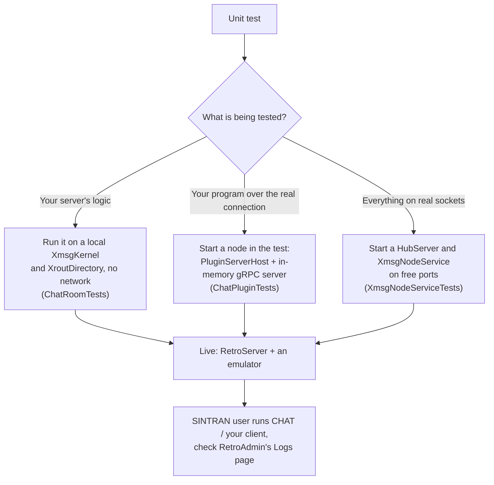

# Building XMSG programs

How to write a server and a client in C#, set them up to reach RetroServer, and test them. The two samples in
`samples/` are complete versions of what this page builds.

## 1. Switch on RetroServer's node

RetroServer reads `xmsgnode-config.json` from its data folder (by default `Documents\RetroFS`, or the folder named by
the `RETROFS_DATA_PATH` variable). The file is written with the defaults the first time RetroServer starts; the node
is **off** until you switch it on.

```json
{
  "Enabled": true,
  "SystemNumber": 19998,
  "PeerSystemNumber": 102,
  "Ethernet": "tcp:127.0.0.1:5010",
  "ProgramBindAddress": "127.0.0.1",
  "ProgramPort": 5011,
  "ProgramToken": "a-long-random-secret",
  "ProgramLogMinimum": "Information",
  "Motd": null
}
```

| Key | What it does | Default |
|---|---|---|
| `Enabled` | Runs the node | `false` |
| `SystemNumber` | RetroServer's own XMSG system number. Must be unique on the network, and not the number an `xmsgrunner` on the same computer uses | none: required |
| `PeerSystemNumber` | The one machine the node talks to (one only, for now) | none: required |
| `Ethernet` | The segment to join; normally RetroServer's own hub, which must be on as well (`xmsghub-config.json`) | `tcp:127.0.0.1:5010` |
| `ProgramBindAddress`, `ProgramPort` | Where programs connect | `127.0.0.1`, `5011` |
| `ProgramToken` | The secret every program must send. Empty means no check (insecure mode). When set it is always checked, also on this computer | empty |
| `ProgramLogMinimum` | The lowest level of log line kept from programs: `Trace`, `Debug`, `Information`, `Warning`, `Error`, `Critical`, `None` | `Information` |
| `Motd` | Middle line of the login banner of RetroServer's own terminal server | built in |

Every key can also be given for one run on RetroServer's command line, for example `--XmsgNode:Enabled=true`.

**RetroServer keeps no settings for programs.** A program tells RetroServer what it needs when it connects: the name
to claim, the seats, the ports. The token is the only thing the two must agree on.

## 2. A server

```csharp
using Grpc.Net.Client;
using RetroIO.Protocols.Xmsg;
using RetroIO.Protocols.Xmsg.Api;
using RetroIO.Protocols.Xmsg.Plugins.Client;

using GrpcChannel channel = GrpcChannel.ForAddress("http://127.0.0.1:5011");
await using PluginConnection node = await PluginConnection.ConnectAsync(channel, "my-server", "1.0", token: "a-long-random-secret");

IXmsgKernel kernel = node.Kernel;     // the XMSG calls: ports, buffers, send, receive
IXroutNames names = node.Names;       // the name calls: claim a name, send a letter

XmsgPortNumber port;
kernel.OpenPort(out port);
XmsgMagicNumber me;
kernel.ConvertPortToMagic(port, out me);
names.RegisterConnectionPort("*MYSERVICE", me, 20, true);   // 20 seats, unique name

while (!node.IsClosed)
{
    XmsgReceiveResult got = kernel.Receive(port, XmsgWaitOptions.None);
    if (!got.Received) { Thread.Sleep(10); continue; }
    // read it, answer the sender's magic number with kernel.Send(...)
}
```

What matters:

- **`Kernel` and `Names` are the same interfaces a server inside a node uses** (`IXmsgKernel`, `IXroutNames`). Code
  written against them runs in both places unchanged. The chat server in `RetroIO.Protocols.Xmsg.Chat` is written
  that way.
- **Calls block** until RetroServer answers, at most `CallTimeout` (10 seconds); a timeout comes back as an error
  status, never as success.
- **Buffers stay in your program.** Reserving, writing, reading and releasing a message buffer happen locally; only
  opening and closing ports, sending, and arrivals cross the connection.
- **A letter arrives with its header first** (message type routed, `XMROU`): your data starts at `4 + the header's
  length word`. `XroutLetter.UserDataOffset` works it out. See the [protocol reference](protocol-reference.md#letters).
- **Send to clients as "secure"** (`XmsgSendFlags.Secure`) when you need to know a client has gone. A message to a
  closed port then comes back to you as a returned message (`XMTRE`) whose sender field names the port that is gone.
  The chat server frees the seat of a member that way, as the SINTRAN chat server does.
- **When the connection ends, RetroServer releases everything** the program held: every port and every name.

The whole thing as a program: `samples/RetroIO.Samples.ChatServer/Program.cs`.

## 3. A client

```csharp
await using PluginConnection node = await PluginConnection.ConnectAsync(channel, "my-client", "1.0", token: "...");
ChatClient chat = new ChatClient(node.Kernel, node.Names, "RONNY");
chat.Join("*CHAT", string.Empty);       // a letter to the name; the server answers with a Welcome
while (!chat.IsJoined) { foreach (ChatMessage m in chat.Poll()) { /* show it */ } Thread.Sleep(10); }
chat.Say("HELLO");
```

A client is the same connection: it opens a port, sends a **letter** to a name (`IXroutNames.SendLetter`), and from
then on talks port to port with whoever answered.

The whole thing as a program: `samples/RetroIO.Samples.ChatClient/Program.cs`. It waits until the server has let it
in before it says anything, and on end of input waits a moment for answers before it leaves.

## 4. The program's own settings

Each sample reads a JSON file next to the program, written with the defaults the first time it runs. Command-line
flags override it for one run only.

```json
{ "Node": "http://127.0.0.1:5011", "Token": "a-long-random-secret", "Name": "*CHAT", "Seats": 20, "Greeting": "Welcome" }
```

Follow the same pattern in your own program: the address and the token in a file, never only on a command line
(a token on a command line shows in the process list).

## 5. Testing



The three kinds of test, with a working example of each in `RetroIO.Protocols.Xmsg.Plugins/tests` and
`RetroIO.Protocols.Xmsg.Chat/tests`:

1. **Logic only.** Give your server a local `XmsgKernel` and an `XroutDirectory`. No sockets, runs in milliseconds.
2. **Over the real connection, in memory.** `ChatPluginTests` starts a `PluginServerHost` behind an in-memory gRPC
   server and a pump thread, connects real `PluginConnection`s to it, and can inject frames as if a SINTRAN machine
   sent them.
3. **On real sockets.** `XmsgNodeServiceTests` starts a hub and RetroServer's node on free ports and connects over
   TCP: the same path as a live run.

Then a **live run**: RetroServer with hub and node on, an emulator on the hub, your program started, and the
result checked from the SINTRAN side. Its log lines show in RetroAdmin (see [Logging](logging.md)).

## 6. When it does not connect

| What you see | Why |
|---|---|
| `could not connect` | RetroServer is not running, the node is off, or the address/port is wrong |
| `The node refused the Hello: -24 Wrong or missing token.` | The token differs from `ProgramToken` (-24 is XEPVR, "privilege request refused") |
| `RegisterName` answers 3 (XRDDF) | Another port already holds that name |
| A letter answers 2 (XRUNN) | Nobody holds that name |
| Nothing arrives from SINTRAN | The node has not heard from its peer yet; RetroServer's log says `heard from <peer>; the link is up` once it has |
