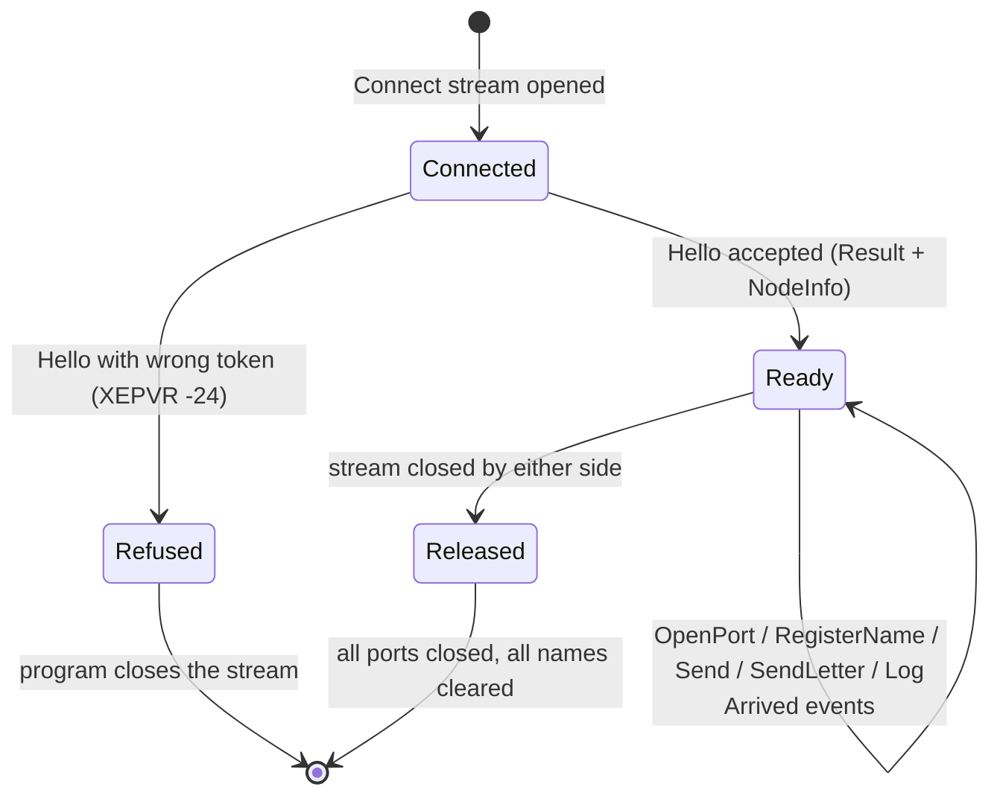
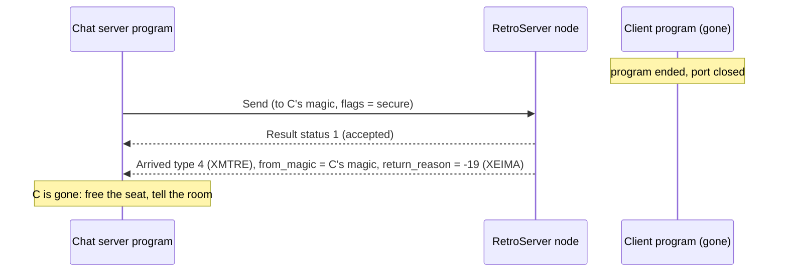

# Protocol reference

The connection between an XMSG program and RetroServer, for anyone writing a library in another language. The
authority is the file `RetroIO.Protocols.Xmsg.Plugins.Contracts/src/xmsg_plugin.proto`; this page explains it and
collects every number a program needs. Package `retroio.xmsg.plugin.v1`, protocol revision **1**.

## The connection

- **gRPC over HTTP/2, without TLS**, to `ProgramBindAddress:ProgramPort` (default `127.0.0.1:5011`). The port speaks
  HTTP/2 only ("prior knowledge"); most gRPC libraries do this by themselves for an `http://` address.
- **One call, `XmsgPluginHost.Connect`, with a stream each way, open for the program's whole life.**
  The program writes `PluginRequest`s; RetroServer writes `HostEvent`s.
- **Every request carries an `id` the program chooses.** RetroServer answers it with exactly one `Result` whose
  `answers_id` is that id. Exception: `Log` is never answered.
- **Answers can arrive between arrivals**, and arrivals (`Arrived`) answer nothing. Read the stream on its own thread
  and match `Result`s to waiting calls by id.
- **The first request must be `Hello`.** Anything else first is answered with XEILF (-18).
- **Closing the stream releases everything**: every port the program opened is closed and every name it claimed is
  cleared.

## Requests (program to RetroServer)

`PluginRequest { uint32 id = 1; oneof body { ... } }`

| Field | Message | XMSG call it stands for | Answer: `status` | Answer: `value` |
|---|---|---|---|---|
| 2 | `Hello` | (none; first request) | 1, or XEPVR (-24) for a wrong token | RetroServer's system number, plus `node` |
| 3 | `OpenPort` | XFOPN | XMSG status | the new port's magic number |
| 4 | `ClosePort` | XFCLS | XMSG status | |
| 5 | `RegisterName` | XSNAM, or XSCRS when `connection_port` | XROUT status | |
| 6 | `AdjustSeats` | XSNSP | XROUT status | |
| 7 | `ClearName` | clear a name | XROUT status | |
| 8 | `Send` | XFSND | XMSG status | |
| 9 | `SendLetter` | XSLET | XROUT status | |
| 10 | `Log` | (none) | **not answered** | |

### Hello

| # | Field | Meaning |
|---|---|---|
| 1 | `string plugin_name` | What the program calls itself. Used in RetroServer's log categories (`XmsgProgram.<plugin_name>`) |
| 2 | `string version` | The program's own version, for people. Not checked |
| 3 | `string token` | Must equal RetroServer's `ProgramToken` when one is set; empty otherwise |
| 4 | `uint32 protocol_revision` | The revision of the `.proto` file the program was built with (`PROTOCOL_REVISION_CURRENT`) |
| 5 | `repeated string features` | What the program can do. None are defined yet |

The accepted answer carries `Result.node`, a `NodeInfo`:

| # | Field | Meaning |
|---|---|---|
| 1 | `uint32 protocol_revision` | RetroServer's revision |
| 2 | `repeated string features` | `"token"`, `"returned-messages"`, `"log"` |
| 3 | `LogLevel log_minimum` | The lowest log level RetroServer keeps from this program |

### OpenPort, ClosePort

`OpenPort` has no fields. `ClosePort { uint32 magic = 1; }` names a port the program opened; a port that is not
the program's is refused with XEIPN (-22).

### RegisterName, AdjustSeats, ClearName

| Message | Fields |
|---|---|
| `RegisterName` | `string name = 1`, `uint32 magic = 2` (one of the program's ports), `bool connection_port = 3`, `int32 seats = 4`, `bool unique = 5` |
| `AdjustSeats` | `string name = 1`, `int32 delta = 2` |
| `ClearName` | `string name = 1` |

A **plain name** (`connection_port` false, XSNAM) just points at the port. A **connection port** (true, XSCRS) has
free connections ("seats"): XROUT spends one for every letter it forwards to the name, and refuses letters when none
are left (XRNSP, 4). The server gives seats back with `AdjustSeats` (+1 when a letter did not seat anybody, or when a
member leaves).

### Send

| # | Field | Meaning |
|---|---|---|
| 1 | `uint32 from_magic` | One of the program's ports |
| 2 | `uint32 to_magic` | Where it goes: a port on any machine |
| 3 | `bytes data` | The message |
| 4 | `uint32 flags` | XMSG send options, see [Send options](#send-options) |

### SendLetter

`string name = 1`, `uint32 from_magic = 2`, `bytes data = 3`. RetroServer puts the letter header in front of
`data`, as XROUT does, and delivers it to whoever holds the name, on any machine.

### Log

See [Logging](logging.md). `LogLevel level = 1`, `string category = 2`, `string text = 3`, `int64 unix_time_ms = 4`,
`string exception = 5`.

## Events (RetroServer to program)

`HostEvent { oneof body { Result result = 1; Arrived arrived = 2; } }`. A program must **ignore an event it does not
know**; newer RetroServers may add some.

### Result

| # | Field | Meaning |
|---|---|---|
| 1 | `uint32 answers_id` | The request's `id` |
| 2 | `int32 status` | XMSG status or XROUT status, by request (see the table above) |
| 3 | `uint32 value` | Magic number for `OpenPort`, system number for `Hello`, else 0 |
| 4 | `string text` | Words for a person when something was refused |
| 5 | `NodeInfo node` | Only in the accepted answer to `Hello` |

### Arrived

| # | Field | Meaning |
|---|---|---|
| 1 | `uint32 to_magic` | The program's port it arrived on |
| 2 | `uint32 from_magic` | The sender. On a returned message: the port it **could not reach** |
| 3 | `int32 message_type` | See [Message types](#message-types) |
| 4 | (reserved) | |
| 5 | `bytes data` | The message. A letter (type 2) starts with its header |
| 6 | `int32 return_reason` | On a returned message (type 4) only: why it came back, an XMSG error number |

## Numbers

### Status

An **XMSG status** is `1` for completed, `0` for "nothing yet", and a negative **XMSG error** for a failure. An
**XROUT status** is `0` (XRSOK) for success and a positive **XROUT error** otherwise. These are the COSMOS
Programmer Guide's own numbers (ND-60.164.3).

XMSG errors a program is likely to meet (full list: `RetroIO.Protocols.Xmsg/src/Enums/XmsgError.cs`):

| Number | Name | Meaning |
|---|---|---|
| -18 | XEILF | Illegal function: request before Hello, or a request RetroServer does not know |
| -19 | XEIMA | Invalid magic number: no such port is open |
| -20 | XEMFL | Message space full, or buffer not available |
| -22 | XEIPN | Illegal port number: not one of the program's ports |
| -24 | XEPVR | Privilege request refused: wrong or missing token |
| -33 | XENOS | Remote system not defined |
| -36 | XEPCL | Remote port closed while the message was queued |

XROUT errors (full list: `XroutError`):

| Number | Name | Meaning |
|---|---|---|
| 0 | XRSOK | OK |
| 2 | XRUNN | Unknown name |
| 3 | XRDDF | Another port already has this name |
| 4 | XRNSP | No free connection (seat) left |
| 7 | XRUNM | Unknown magic number |
| 10 | XRPRV | Caller was not privileged |
| 30 | XRBUS | Service points busy |

### Message types

| Number | Name | Meaning |
|---|---|---|
| 1 | XMTNO | Normal message, port to port |
| 2 | XMROU | Routed by XROUT: a letter, header first |
| 3 | XMTHI | High priority |
| 4 | XMTRE | Returned: a secure message that could not be delivered |

### Send options

Bits of `Send.flags` (`XmsgSendFlags`):

| Bit | Value | Name | Meaning |
|---|---|---|---|
| 9 | 0x0200 | Secure (XFSEC) | Return the message to the sender (type 4) if it cannot be delivered or the port closes. Kept by the sending machine; not written into the frame (measured on D100) |
| 11 | 0x0800 | Forward (XFFWD) | Keep the original sender; the receiver sees a routed message |
| 13 | 0x2000 | HighPriority (XFHIP) | Queue ahead of normal messages |

### Magic numbers

A port's address, 32 bits: `system number << 16 | port number << 7 | random`. The port number is 9 bits (1-511),
the random part 7 bits. The high 16 bits tell which machine the port is on.

Example: system 100, port 5, random 43 is `0x0064_02AB`.

### Letters

What a server receives for a letter (type 2), as XROUT gives it on a SINTRAN machine (COSMOS Programmer Guide,
appendix B):

| Offset | Size | Contents |
|---|---|---|
| 0 | 1 | serial number, chosen by the sender |
| 1 | 1 | service, 65 (XSLET) |
| 2 | 2 | length of the parameter blocks that follow, big-endian |
| 4 | that length | parameter blocks; the name is a string block: byte 255, byte length, the name |
| 4 + length | rest | the sender's data |

Measured on D100, 2026-08-18, a SINTRAN chat client joining:
`123 65 0 12 | 255 10 'CHAT-LOBBY' | 1 5 'RONNY' 0 0` - the data starts at offset 16.

### Log levels

| Number | Name |
|---|---|
| 0 | Trace |
| 1 | Debug |
| 2 | Information |
| 3 | Warning |
| 4 | Error |
| 5 | Critical |
| 6 | None (only as a minimum: nothing kept) |

The same names and numbers as RetroServer's own log levels (.NET `Microsoft.Extensions.Logging.LogLevel`).

## Writing a library in another language

1. Generate code from `xmsg_plugin.proto` with your language's protobuf and gRPC tools.
2. Open `Connect`, start a reader for `HostEvent`s, send `Hello` first with your `protocol_revision`.
3. Keep a table of waiting requests by `id`; complete each when its `Result` arrives. Ignore unknown events.
4. Use a feature only when `NodeInfo.features` lists it.
5. Keep message buffers locally, as the C# library does: the connection carries only whole messages.
6. Copy the numbers on this page; the C# files named above are the source for the full lists.
