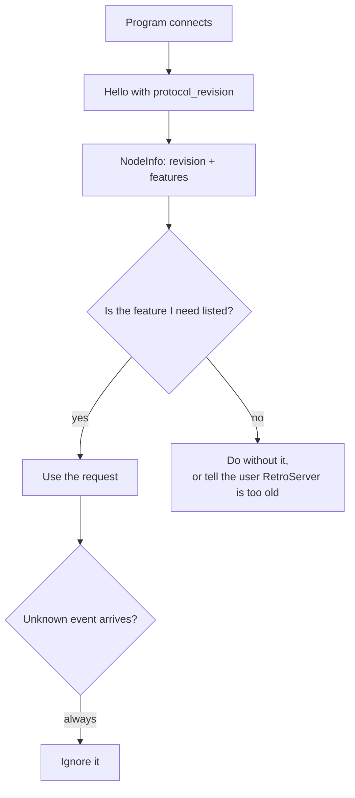
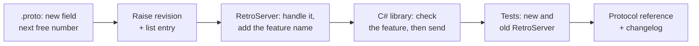

# Versioning and extending the connection

How the connection between programs and RetroServer changes without breaking programs that are already written, and
the steps for adding a new message.

## The rules

1. **Within `v1` the `.proto` file only grows.** Add fields, add requests, add events, add enum values. Never
   renumber a field, never reuse a number, never change a field's type. A field that is removed is marked
   `reserved` with its number (field 4 of `Arrived` already is).
2. **Each side says what it can do.** The program sends `protocol_revision` (and, later, `features`) in `Hello`;
   RetroServer answers with its own `protocol_revision` and `features` in `NodeInfo`. **Neither side refuses the other
   for being older or newer.** A program uses a newer request only when RetroServer listed its feature.
3. **An unknown request is answered with XEILF (-18), "Unknown request."** So an older RetroServer gives a clear error
   rather than silence. (A `Log` request is the exception: a program sends it only when `"log"` was listed.)
4. **An unknown event is ignored** by the program. The C# library does this.
5. **A change that cannot be made by adding** (a field that must change meaning, a different call) is a new package,
   `retroio.xmsg.plugin.v2`, served next to `v1` on the same port until `v1` is removed on purpose.
6. **The revision number goes up by one** each time something is added, with a line in the list at
   `enum ProtocolRevision` in the `.proto` file.

| Revision | Date | Added |
|---|---|---|
| 0 | 2026-11-10 | The first contract (programs built before revisions existed send 0) |
| 1 | 2026-11-10 | `Hello.token`, `Arrived.return_reason`, `protocol_revision`, `features`, `Log`, `NodeInfo` |

## Adding a new message, step by step

Example: a request that lets a program list the names it holds.

1. **The `.proto` file.** Add `ListMyNames list_my_names = 11;` to `PluginRequest`'s `oneof` (the next free
   number), define `message ListMyNames {}`, and decide what the answer carries. If the answer needs more than
   `Result.value`/`text`, add an optional field to `Result` (next free number) or a new event to `HostEvent`.
   Write a comment saying which XMSG or XROUT call it stands for, and the feature name.
2. **Raise the revision.** `PROTOCOL_REVISION_CURRENT` goes up by one; add a line to the list above the enum and to
   the table on this page.
3. **RetroServer's side** (`PluginServerHost.Apply`): handle the new case on the pump thread, answer with exactly one
   `Result`, and add the feature name in `DescribeNode`.
4. **The C# library** (`PluginConnection` and friends): a method that checks `NodeFeatures` first, then sends.
5. **Tests both ways**: the new request answered by a current RetroServer, and an older RetroServer (no feature)
   handled cleanly by the library.
6. **Documents**: the [protocol reference](protocol-reference.md) table and field list, and the changelog.

## What the C# code generation does for you

The `.proto` file is the only definition. Each build generates the C# messages and the gRPC client and server from
it (Grpc.Tools, project `RetroIO.Protocols.Xmsg.Plugins.Contracts`). The file is also shipped in the NuGet package
under `proto/`, so a library in another language is generated from exactly the same file.
