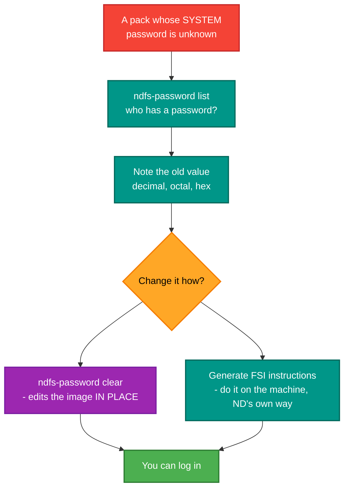

# ndfs-password

<!-- A still screenshot of RetroIO.Tools.NdfsPassword doing its job. PNG, under 10 MB. Uncomment when
     the capture exists; keep the alt text, it is all a screen reader gets.

-->

## What it is

A command-line tool for the **passwords in an NDFS user file**: list the users and whether each has one, clear
one, and generate the equivalent FILE-SYSTEM-INVESTIGATOR instructions.

## Why you need it

Because a system pack you have just recovered has users on it whose passwords nobody alive knows, and SINTRAN
will not let you in without one. There is no "forgot password" on a 1980s minicomputer.

Clearing the password in the image is the way in. It is also the only way in if the `SYSTEM` user itself is
locked, because every other route to fixing it requires being logged in as `SYSTEM`.

The **FILE-SYSTEM-INVESTIGATOR instructions** matter as much as the direct edit. FSI is ND's own tool, run on the
machine; generating the instruction sequence means the same change can be made the authentic way, or checked
against what this tool did. It also means the knowledge is transferable to a machine this tool cannot reach.

It shows the **old value** in decimal, octal and hex before clearing, which is what makes the operation
reversible — write it down and you can put it back.

## What you can use it for

- Finding out **which users have passwords** on an image, and which do not.
- Clearing one, by username or by user index.
- Getting into a pack whose `SYSTEM` password is unknown.
- Producing FSI instructions to make the same change on the machine itself.
- Recording the old value before changing it, so the change can be undone.

## Prerequisites

| # | Requirement | Why | How to check |
|---|---|---|---|
| P1 | .NET SDK as pinned in `global.json`, or the published exe | To build or run | `dotnet --info` |
| P2 | `.\src\build.ps1` run at the repository root | Produces `src\publish\win-x64\ndfs-password.exe` | `dir src\publish\win-x64\ndfs-password.exe` |
| P3 | An NDFS image with a user file | Anything | |
| P4 | **A copy of the image** | `clear` writes **in place** | copy it to a scratch directory first |
| P5 | The old value written down | To be able to undo it | The tool prints it — keep it |
| P6 | A reason to be doing this | It is a credential change on somebody's system | |

> **`clear` modifies the file you give it.** Work on a copy, and note the old value it prints before you lose it.

## Where it fits



## Related

- [`ndfs-analyzer`](../RetroIO.Tools.NdfsAnalyzer/README.md) — analysis, repair, and the SINTRAN initial-command
  buffer.
- [`RetroIO.Storage.Ndfs`](../../RetroIO.Storage.Ndfs/README.md) — `UserEntry`, `UserFile` and the
  three-tier access model, as libraries.

---

Command-line tool for managing NDFS user passwords.

## Features

- ✅ List all users with password status
- ✅ Clear user passwords programmatically
- ✅ Generate FILE-SYSTEM-INVESTIGATOR instructions
- ✅ Shows old password values (decimal/octal/hex)
- ✅ Access by username or user index

## Installation

```powershell
# The usual way: build.ps1 builds, tests and publishes every tool
# from the repository root
.\src\build.ps1
```

The executable is then `src\publish\win-x64\ndfs-password.exe`.

To build just this project:

```powershell
cd tools\RetroIO.Tools.NdfsPassword
dotnet build -c Release -nodeReuse:false
```

The project folder used to be `tools\NdfsPasswordTool`; it is `tools\RetroIO.Tools.NdfsPassword` now, and the old
`build-password-tool.bat` is gone — `build.ps1` replaces it.

## Usage

### List Users

```bash
ndfs-password list disk.img
```

Output:
```
Found 3 user(s) in disk.img:

┌──────┬──────────────────┬──────────┬──────────┬────────────┐
│ Index│ Username         │ Reserved │ Used     │ Password   │
├──────┼──────────────────┼──────────┼──────────┼────────────┤
│    0 │ SYSTEM           │     1000 │      500 │ 0x14E5     │
│    1 │ ADMIN            │     2000 │     1200 │ CLEARED    │
│    2 │ USER1            │      500 │      100 │ 0x0042     │
└──────┴──────────────────┴──────────┴──────────┴────────────┘
```

### Clear Password

Clear by username:
```bash
ndfs-password clear disk.img SYSTEM
```

Clear by user index:
```bash
ndfs-password clear disk.img 0
```

Output:
```
✓ Password cleared for user 'SYSTEM'
  Old password:  5349 (decimal) = 012345 (octal) = 0x14E5 (hex)
  New password: 0 (cleared)
✓ Changes saved to disk.img
```

### Get Manual Instructions

```bash
ndfs-password instructions disk.img ADMIN
```

Or save to file:
```bash
ndfs-password instructions disk.img ADMIN > clear-admin.txt
```

Output includes exact CHANGE-PAGE commands with calculated page numbers and offsets.

## Commands

| Command | Description | Modifies Disk? |
|---------|-------------|----------------|
| `list <image>` | List all users | No |
| `clear <image> <user>` | Clear password programmatically | **Yes** |
| `instructions <image> <user>` | Get manual instructions | No |
| `manual <image> <user>` | Same as instructions | No |
| `help` | Show help | No |

## Examples

```bash
# List users
ndfs-password list disk.img

# Clear password for SYSTEM user
ndfs-password clear disk.img SYSTEM

# Clear password for user index 5
ndfs-password clear disk.img 5

# Get manual instructions
ndfs-password instructions disk.img ADMIN

# Save instructions to file
ndfs-password manual disk.img ADMIN > instructions.txt
```

## Security Notes

- **Audit Trail**: Log when this tool is used
- **Access Control**: Restrict who can run this tool
- **Backup First**: Always backup before using `clear` command
- **Read-Only**: Use `instructions` when you don't want to modify the disk

## Error Messages

| Error | Cause | Solution |
|-------|-------|----------|
| File not found | Image path is wrong | Check file path |
| User not found | Invalid username/index | Use `list` to see users |
| Access denied | File is read-only | Check file permissions |
| Failed to clear | Disk mounted read-only | Ensure write access |

## Build & Run

```powershell
# Build
dotnet build -c Release

# Run
.\bin\Release\net9.0\ndfs-password.exe list disk.img
```

Or use from project root:
```powershell
dotnet run --project tools\NdfsPasswordTool -- list disk.img
```

## Exit Codes

- `0` - Success
- `1` - Error (see error message)

## Requirements

- .NET 9.0 or later
- Windows/Linux/macOS

## License

MIT License - RetroCore Labs
