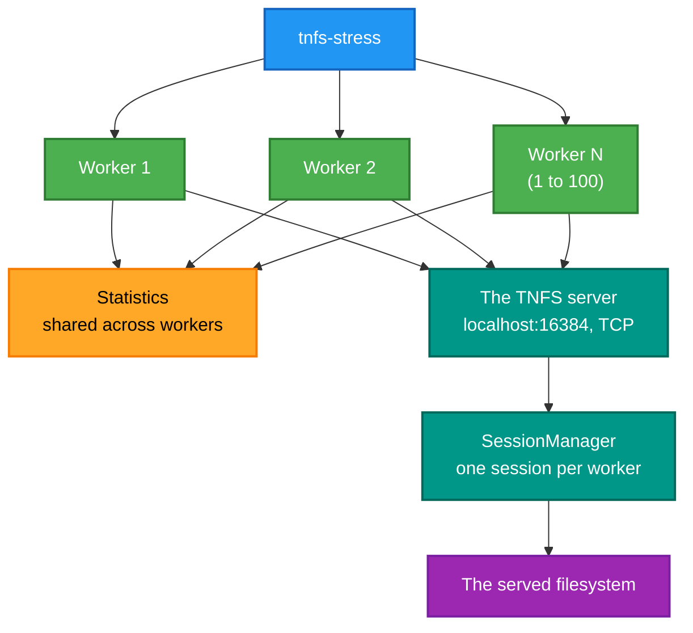
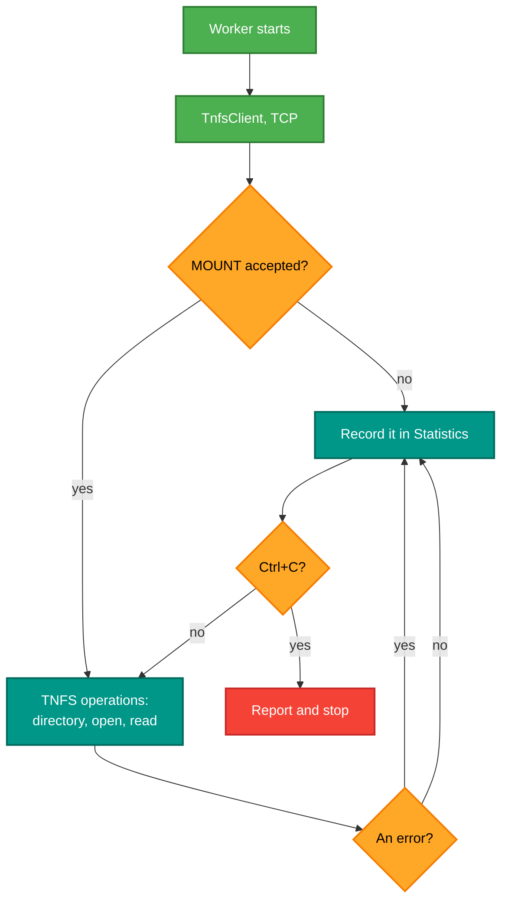

# tnfs-stress

<!-- A still screenshot of RetroIO.Tools.TnfsStress doing its job. PNG, under 10 MB. Uncomment when
     the capture exists; keep the alt text, it is all a screen reader gets.

-->

## What it is

A load generator for a **TNFS server**. It logs in with a username and password, then runs as many concurrent
worker threads as you ask for, each hammering the server with TNFS operations and reporting what happened.

## Why you need it

One client mounting a share proves the protocol works. It proves nothing about what happens when eight machines
mount it at once, or when the same session is used hard for an hour.

The faults this finds are the ones a single client never will: session handling under concurrency, handle
exhaustion, a race in the session manager, memory growth per request, and a server that slows down rather than
refusing cleanly when it is full. Those are exactly the failures that appear when somebody else starts depending
on the server.

It is also how the pooled-buffer work in the TNFS server is checked. `TnfsBuffer` and `TnfsMessage` exist to
make message handling allocation-free; the only way to see whether that holds is to push a lot of messages
through and watch.

## What you can use it for

- Finding concurrency faults in the TNFS server.
- Measuring how it behaves with 1 thread versus 50.
- Watching for memory growth over a long run.
- Checking that it refuses work cleanly when saturated, instead of degrading silently.
- Exercising authentication repeatedly, which a single mount does once.

## Prerequisites

| # | Requirement | Why | How to check |
|---|---|---|---|
| P1 | .NET SDK as pinned in `global.json`, or the published exe | To build or run | `dotnet --info` |
| P2 | `.\src\build.ps1` run at the repository root | Produces `src\publish\win-x64\tnfs-stress.exe` | `dir src\publish\win-x64\tnfs-stress.exe` |
| P3 | **A TNFS server on `localhost:16384`** | The target is hard-coded — see below | `netstat -ano \| findstr 16384` |
| P4 | A valid username and password | It authenticates on every session | A RetroIDP user |
| P5 | Something to read | The workers do real operations | Files in the served root |
| P6 | A server you are willing to load | It is a stress tool | **Not** a production server |

> **The target is hard-coded to `localhost` port `16384`, over TCP.** There is no host or port argument. To aim
> it elsewhere, change `WorkerThread`'s construction in the source, or run the tool on the machine hosting the
> server. Worth knowing before hunting for a flag that does not exist.

## Running it

It is **interactive** — there are no command-line options:

```
Username: <the account>
Password: ****          (masked as you type)
Number of threads: 8    (1 to 100)
```

Then it runs until **Ctrl+C**, printing per-thread progress and errors, and a summary on the way out.

| Prompt | Accepted |
|---|---|
| Username | Anything non-empty |
| Password | Anything non-empty, echoed as `*` |
| Number of threads | **1 to 100**; anything else is rejected and asked again |

## How it loads the server



Each worker opens **its own** `TnfsClient` over TCP and its own session, which is the point: the server's session
manager is what is being tested, and one shared session would not test it.

## One worker's loop



**Errors are counted, not fatal.** A stress tool that stopped on the first refusal would measure how long until
the first refusal, which is not the question.

## Related

- [`RetroIO.Protocols.Tnfs`](../../RetroIO.Protocols.Tnfs/README.md) — the server and the client being
  exercised.
- `RetroServer.Service` in the RetroServer repo — the usual host for the server under test.
- The management API exposes live TNFS statistics, which are worth watching while this runs:
  [`RetroIO.Management.Api`](../../RetroIO.Management.Api/README.md).
