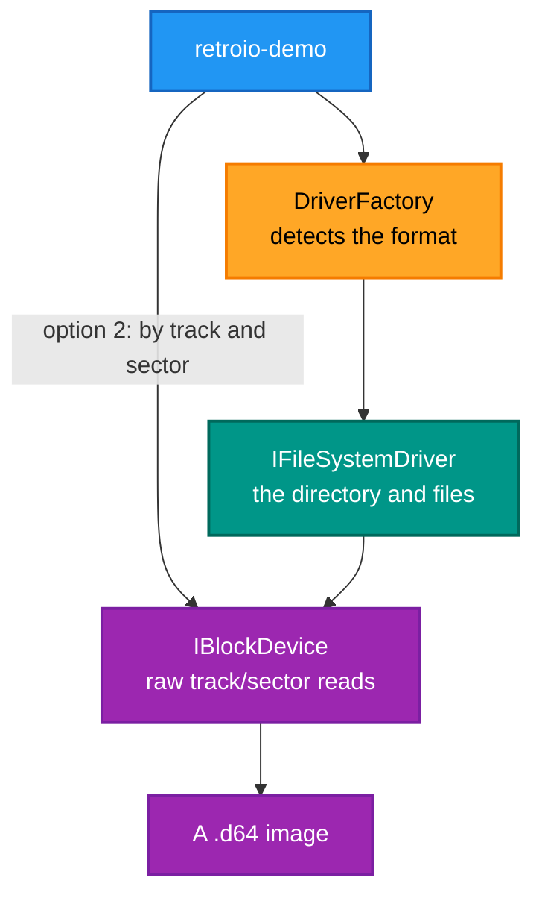

# retroio-demo

## What it is

An interactive console application that mounts a disk image, lists it, reads a file and reads a raw sector — a
**worked example** of the RetroIO library surface, in a few hundred lines.

## Why you need it

Two uses, and they are different audiences.

**As a reader**: it is the shortest path from "RetroIO has forty-four packages" to "this is how you open an image
and read a file". The library is big; this shows the five calls you actually need.

**As a user**: it is a quick way to look inside an image without a file manager. Mount it, see the directory,
hex-dump a file, read a raw sector. When a format driver is suspected of misreading something, this is how you
check by hand at the block level.

It deliberately demonstrates the **block** path as well as the file path. Reading track 18 of a D64 directly is
how you confirm what the driver should have found in the directory.

## What you can use it for

- Learning the library by reading one small program.
- Looking inside a D64 without installing anything larger.
- **Checking a driver** against the raw sectors it claims to have read.
- Seeing PETSCII converted to ASCII, and the file types a CBM directory carries.
- Exploring the block chaining mechanism by hand.

## Prerequisites

| # | Requirement | Why | How to check |
|---|---|---|---|
| P1 | .NET SDK as pinned in `global.json` | To build or run | `dotnet --info` |
| P2 | A disk image | There is nothing to show without one | A `.d64` to start with |
| P3 | `.\build.ps1` run, or `dotnet run` | Either works | `dir publish\win-x64\retroio-demo.exe` |
| P4 | A terminal that renders box-drawing characters | The output is boxed | Any modern terminal |

---

Interactive console application demonstrating RetroFS capabilities.

## Features

- **Mount D64 disk images** - Automatic format detection
- **Directory listing** - View all files with metadata (type, size, blocks)
- **File reading** - Extract files with hex dump display
- **Block access** - Read individual sectors (Track/Sector addressing)

## Usage

```powershell
# From the repository root, with an image path
dotnet run --project tools\RetroIO.Demo\RetroIO.Demo.csproj path\to\disk.d64

# Or interactively
dotnet run --project tools\RetroIO.Demo\RetroIO.Demo.csproj

# Or the published executable, after .\build.ps1
publish\win-x64\retroio-demo.exe path\to\disk.d64
```

The project path used to be written as `demo/RetroIO.Demo.csproj`; it lives in `tools/` now.

## What it exercises



Both paths to the same image: through the driver, and straight at the sectors. Comparing the two is the point.

## Example Session

```
╔═══════════════════════════════════════════════════════════════════════╗
║                           RETROFS DEMO                                ║
║              Accessing yesterday's data with today's standards       ║
╚═══════════════════════════════════════════════════════════════════════╝

Mounting: games.d64
  Type: D64
  Label: COMMODORE GAMES
  Block Access: Yes

╔═════════════════════════════════════════════════════════════════╗
║                        DIRECTORY LISTING                        ║
╠═════════════════════════════════════════════════════════════════╣
║  NAME                 TYPE    SIZE     BLOCKS                   ║
╠═════════════════════════════════════════════════════════════════╣
║  PITFALL             PRG      8382 B    34                      ║
║  ADVENTURE           PRG     12700 B    51                      ║
║  README              SEQ       508 B     3                      ║
╚═════════════════════════════════════════════════════════════════╝

Options:
  1. Read a file
  2. Read a block/sector
  3. Exit

Choose option:
```

## Supported Operations

### 1. Read File
- Enter filename from directory listing
- Displays file size and hex dump (first 256 bytes)
- Shows both hex values and ASCII representation

### 2. Read Block/Sector
- Enter track number (1-35)
- Enter sector number (0-20)
- Displays raw 256-byte sector data in hex dump format

## Requirements

- .NET 9.0 or later
- Valid D64 disk image file

## D64 Format Support

- ✅ 35-track (174,848 bytes)
- ✅ 40-track (196,608 bytes)
- ✅ 42-track (205,312 bytes)
- ✅ Images with error tables
- ✅ PETSCII to ASCII conversion
- ✅ All file types (PRG, SEQ, USR, REL, DEL)

## Architecture Demonstration

This demo showcases:
- **IProtocolAdapter** - LocalFsAdapter for disk images
- **IFileSystemDriver** - D64Driver with automatic detection
- **URN Context** - Volume-based addressing
- **Block Operations** - Zero-copy Span<byte> I/O
- **Property Bag Metadata** - Flexible filesystem-specific properties

## Next Steps

Try these operations:
1. Mount your own D64 images
2. List directory contents
3. Extract files for analysis
4. Read raw sectors for low-level inspection
5. Explore the block chaining mechanism (Track 18 for directory)
