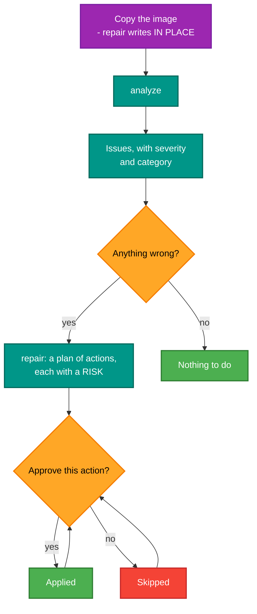
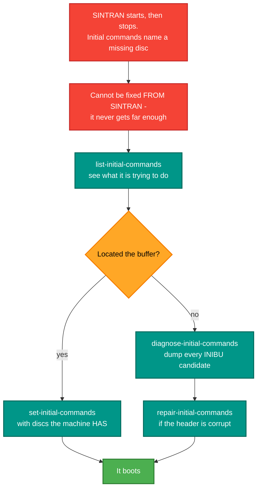
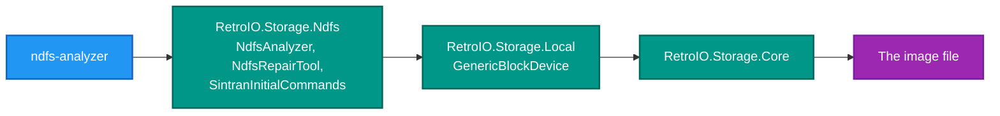

# ndfs-analyzer

## What it is

A command-line tool for **inspecting, verifying and repairing Norsk Data NDFS disk images** — and for reading
and rewriting the SINTRAN III initial-command buffer, the commands SINTRAN runs at every restart.

## Why you need it

These images are thirty years old and many are damaged. When SINTRAN will not boot, or a file cannot be read,
the question is *what exactly is wrong* — which block, which pointer chain, whose quota — and whether fixing it
is safe. Guessing at a hex editor is how an image that was recoverable stops being recoverable.

The initial-command commands are the other half, and they are the reason this tool gets used most. If a system
pack's initial commands name a disc that no longer exists, SINTRAN comes up and then stops, and there is no way
to fix it **from** SINTRAN because the machine never gets far enough. Editing them in the image is the way in.

And the buffer is not a file: it lives at the kernel symbol `INIBU` inside the SINTRAN command segment, whose
disk image is in the segment file. Finding it means walking the segment table — which is why
`diagnose-initial-commands` exists at all.

## What you can use it for

- **Finding out why an image is broken**: `analyze` walks block usage, pointer chains and quota tracking and
  reports each issue with a severity and a category.
- **Fixing it**: `repair` produces a plan where every action carries a stated risk, and asks before each one.
- **Reading the initial commands**, exactly as `@LIST-INITIAL-COMMANDS` prints them.
- **Changing them**, which is how a pack that boots onto a missing disc is rescued.
- **Restoring a corrupted buffer header** with `repair-initial-commands`.
- Listing the object files, and printing one as 7-bit text — a quick look inside without mounting anything.
- `diagnose-initial-commands` when the buffer cannot be located and you need to see every candidate.

## Prerequisites

| # | Requirement | Why | How to check |
|---|---|---|---|
| P1 | .NET SDK as pinned in `global.json`, or the published exe | To build or run | `dotnet --info` |
| P2 | `.\build.ps1` run at the repository root | Produces `publish\win-x64\ndfs-analyzer.exe` | `dir publish\win-x64\ndfs-analyzer.exe` |
| P3 | An NDFS image | Anything | `.ndfs`, `.IMG`, a raw dump |
| P4 | **A copy of the image** | `repair`, `set-initial-commands` and `repair-initial-commands` write **in place** | copy it to a scratch directory first |
| P5 | A backup of the original | Because a repair can make things worse | |
| P6 | The image's disc names | Writing initial commands | They must name a disc the machine really has |

> **`repair` and the `set`/`repair-initial-commands` commands modify the file you give them.** There is no
> separate output path. Work on a copy.

## Commands

```
ndfs-analyzer analyze <image-path>                          Analyse the filesystem
ndfs-analyzer repair <image-path> [--auto]                  Repair it
ndfs-analyzer list-initial-commands <image-path>            Show the SINTRAN initial commands
ndfs-analyzer set-initial-commands <image-path> "CMD" ...    Replace them
ndfs-analyzer repair-initial-commands <image> "CMD" ...      Restore a header-corrupted buffer
ndfs-analyzer diagnose-initial-commands <image-path>        Dump every INIBU candidate (debug)
ndfs-analyzer list-files <image-path>                       List the object files
ndfs-analyzer read-file <image-path> <USER/NAME:TYPE>       Print a file as 7-bit text
```

| Option | Meaning |
|---|---|
| `--auto` | Approve every repair without asking. **Use with caution** — it accepts the high-risk actions too |

### Examples

```powershell
ndfs-analyzer analyze test.ndfs
ndfs-analyzer repair test.ndfs --auto
ndfs-analyzer list-initial-commands SMD0-L.IMG
ndfs-analyzer set-initial-commands SMD0-L.IMG "ENTER-DIR,,DI-75-1,0" "SET-AVAIL" "CC READY"
ndfs-analyzer repair-initial-commands disk.img "ENTER-DIRECTORY,,DISC-SCSI-1,0" "SET-AVAIL"
```

## Analyse before you repair



`--auto` replaces the approval step with yes. That is the right answer for a batch of known-good repairs and the
wrong one for an image you care about.

## Rescuing a pack that will not finish booting



## What it is built on



The work is in [`RetroIO.Storage.Ndfs`](../../src/RetroIO.Storage.Ndfs/README.md); this tool is the command line
over it. Anything it can do is available to a program as a library call.

## Related

- [`ndfs-password`](../RetroIO.Tools.NdfsPassword/README.md) — the passwords in the user file.
- [`RetroIO.Storage.Ndfs`](../../src/RetroIO.Storage.Ndfs/README.md) — the filesystem, the analyser and the
  repair tool as libraries.
